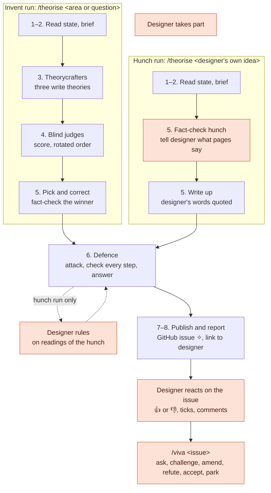

# Theories

A theory is Claude's proposal about how the game works, written from the settled design and tested before the designer sees it. This page is the glossary of that process. Three skills run it: `theorise` writes and defends a theory, `viva` puts it before the designer, and `revisit-theories` keeps open theories up to date. The steps are in the skills; the words are here.

These are process words, not game terms. The game's Glossary is the wiki's term pages. Where a process word looks like a game term, the game term wins: never use "hold" for a move, since Hold is how rooted a memory is.

Theorycrafters, examiners and the viva reason with the designer's principles in `docs/principles.md`.

A theory is a suggestion in every state. It becomes design only when the designer accepts a part of it in a viva and asks for it to be landed.

## The thing itself

- **Theory:** a short proposal that explains several open questions and conflicts at once from the settled design. It may add a new mechanic only when that makes the design simpler.
- **New rule:** a rule the theory adds, numbered R1, R2 and so on. Each is a cost. Each part the designer could accept or strike on its own has its own number.
- **New term:** a word the theory coins because no Glossary term fits. Written in italics until accepted.
- **Answer:** what the theory says to one open question or conflict, by issue number.
- **Earned answer:** an answer that would fall if the theory's rules were deleted. An answer the settled pages already give is free to list, but is not counted.
- **Open:** a new question the theory raises.
- **Weakness:** a flaw the author names itself.

## Source lines

Every new rule and every answer says what it rests on. One line each:

- ✔ **_from_:** a settled rule gives this. Costs nothing.
- ⚠ **_stretches_:** a settled rule used beyond what its page says.
- 🔗 **_needs_:** this holds only if that new rule is accepted.
- ✘ **_overturns_:** a settled rule this changes or breaks.

**Marks.** The sign before each word is its mark. A theory's issue and a viva use the marks so a bill can be read at a glance, always with the word beside them. Two more: ❓ for an Open or something not said yet, and ⚔ for a standing attack or an open objection. In a viva the same marks go on fact-checks: ✔ the pages agree, ✘ the pages clash, ⚠ a stretch or a cost, ❓ no page says, and ➡️ for the pick. Question issues do not use marks: their text renders on the wiki.

## Writing and judging

A theory comes in by one of two ways:

- **Invent run:** theorycrafters write theories and blind judges pick one.
- **Hunch run:** the designer states an idea of their own, a **hunch**. Claude fact-checks it, writes it up and sends it straight to the defence. No theorycrafters, no judges. The designer's words are quoted exactly and no agent changes or reinterprets them.

- **Brief:** the one file every theorycrafter, judge, examiner and author reads. It carries no lean.
- **Theorycrafter:** an agent that writes one theory from the brief.
- **Judge:** an agent that scores the anonymised theories blind, in rotated order.
- **Submitted theory:** the text the defence examines: the winning theory after the judges' fact-check, or the written-up hunch.
- **Author:** the agent that answers for the submitted theory in the defence: the theorycrafter who wrote it, or in a hunch run an agent started for the purpose.

## The defence

The theory is defended like a thesis before the designer ever sees it.

- **Defence:** rounds of attack and answer between the examiners and the author.
- **Examiner:** an agent that attacks the theory through one lens and fixes nothing. **Canon** checks it against the settled design. **Exploiter** tries to break or abuse it as a player would. **Occam** asks what can be cut.
- **Chair:** Claude, running the defence. The chair checks proofs and calls the verdict, and neither attacks nor defends.
- **Attack:** an examiner's objection, with proof.
- **Proof:** a **quote** (the exact line from a page, sheet or closed issue, with its file) or a **worked scenario** (a concrete case walked step by step, each step quoting the page line or ruling it applies, ending in a broken result). No proof, no attack.
- **Unsourced step:** a step of a worked scenario that no page line or ruling gives. No page, no proof: a scenario with one proves nothing.
- **Gap:** what a scenario with an unsourced step becomes: a question for the designer, "no page says whether X". Reported apart from the attacks and listed under Opens, never a standing attack.
- **Standing attack:** an attack whose proof the chair has re-checked and found sound.
- **Round:** the examiners attack, the chair checks, the author answers. Three at most, four if a counter-theory is adopted late.
- **Rebutted:** the author shows the attack is wrong, with its own proof. The author must try this first.
- **Patched:** the author changes the theory to meet the attack.
- **Conceded:** the author withdraws the claim.
- **Counter-theory:** a different reading an examiner proves gives the same answers at lower cost. The author may rebut it, adopt it, or set it beside its own reading.
- **Rival:** a reading or theory that answers the same question differently.
- **Bill:** everything a reading costs, stated on the same terms as its rivals: overturns, stretches, new rules and terms, and what it costs or gains in play.
- **Last word:** after the final round, the author answers each standing attack once more, by rebutting or conceding. It may no longer change the text.
- **Closing judgement:** the author's own short view of what the designer should take from the theory.
- **Open objection:** an attack still standing at the end. Published with its proof and the author's answer.
- **Side finding:** trouble in the settled pages themselves that the defence turned up, with no theory involved. Proposed as a question issue.

## Verdicts

- **Passed:** no attack stood, or every one was rebutted.
- **Passed with corrections:** attacks stood and were patched or conceded. None stands now.
- **Passed with open objections:** attacks still stand, and the core and at least one earned answer survive them.
- **Reduced to a question:** the settled pages do not decide between two or more readings, and every earned answer depends on the choice. Published as a question map.
- **Failed:** the core is broken, or no earned answer is left. Nothing is published.
- **Question map:** what a theory reduced to a question becomes: **what held** (the claims that held against every examiner, numbered H1, H2 and so on), then the **rules** a reading needs (R1, R2 and so on; a rule no reading needs is cut, or becomes an Open), then the **candidate answers** (the readings, numbered A1, A2 and so on), each with its bill. It recommends none.

## The viva

- **Viva:** a sitting where the designer is the final examiner. Claude presents the theory and answers for it. The name is Latin for "with the living voice".
- **Piece:** one thing put to the designer at a time: a claim of what held, a new term, a new rule, an answer, a candidate answer or an open objection.
- **Pick:** Claude's suggestion for a piece, marked ➡️. Never a decision.
- **Move:** what the designer does with a piece:
  - **Ask:** a question or "walk me through a case". Nothing changes.
  - **Challenge:** "this is wrong because". Claude checks the pages and replies once, then the designer rules.
  - **Correct the evidence:** "that page is wrong" or "I have changed my mind". A change to the settled design, not an attack on the theory.
  - **Amend:** "make it X instead". The designer's words go in, credited.
  - **Lean:** a preference. It decides nothing.
  - **Refute:** "it does not work like that". The piece is struck, with the designer's reason.
  - **Accept:** the piece is accepted, at a confidence on the page-status scale.
  - **Park:** no move yet. Leave the piece open and go on. The same sense as on the Parked topics page.
- **Ruling:** the designer's words on the theory: an amendment, a refutation's reason, a clarification, an answer to a question. Recorded bare, quoted exactly.
- **Claude's reading:** at most two lines under a ruling, labelled as Claude's. It carries none of the designer's weight and no ✔ *from* mark without a quoted page line. Anything more, or any case the designer did not name, is a question to the designer.
- **Two layers:** the designer's word is law on the theory, with no proof needed. On the settled design it changes nothing until the designer asks for it to be recorded.
- **Reach:** how far a move changes other pieces. **Wording only:** no other claim changes. **Framing:** it changes a premise other pieces rest on.
- **Stale:** a piece whose premise a move has changed. The examiners attacked the old text. A stale piece cannot be accepted until one more defence round.
- **Moot:** a piece left with nothing to stand on, because a piece it needs was refuted. It is skipped in the viva.
- **Land:** to write an accepted part into the wiki the usual way: answer comments, question issues, pages in both languages, one pull request.
- **Stage:** how far a piece has got, in order: written, defence, viva, defence round, accepted in a viva, recorded on the issue, landed. Each piece has its own stage. A struck or moot piece goes no further; a parked one waits where it is. A stale piece waits at the defence round, then comes back to the viva.

## States and relations

A theory is one issue labelled `kind:theory`, titled `✧ <Title>`. `bun run pull` ignores the label, so the wiki and the Astrolabe do not show it.

- **Unreviewed:** open, no verdict from the designer yet.
- **Promising:** the designer wants it taken to a viva, shown by the designer's 👍 on the issue. No label.
- **Accepted:** accepted in a viva and landed, then closed as completed.
- **Rejected:** refuted or turned down. Closed as not planned, with the reason.
- **Overtaken:** a later decision contradicts its core. Closed with a link, on the designer's yes.

Between two open theories:

- **Independent:** different questions, no shared rule.
- **Rival:** at least one question in common, answered differently. Both stay open.
- **Builds on:** it uses a rule of a promising theory, and falls if that one is rejected.
- **Supersedes:** it gives every answer the older one gives, at no greater cost, and more.

## Revisiting

When questions are settled or pages change, an open theory is checked again. The outcome is one of **unchanged**, **strengthened** (a decision confirmed part of it), **refreshed** (quotes or statuses updated), **weakened** (an answer contradicted, the core intact) or **overtaken**.
